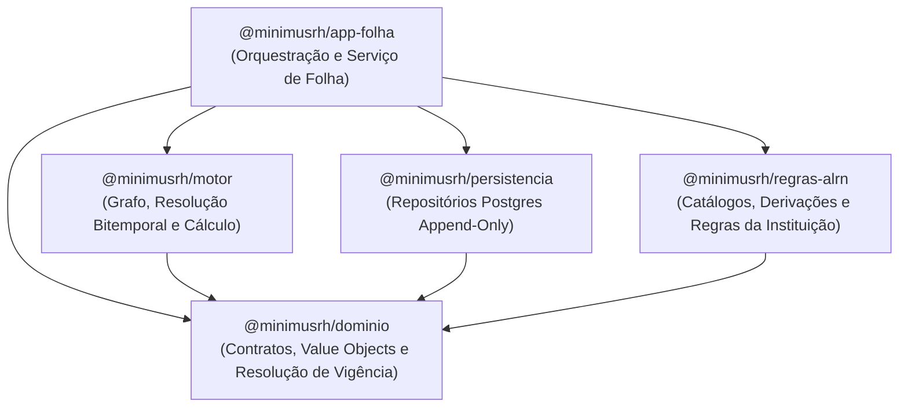

# MinimusRH

> **Dado um conjunto de pessoas e o que aconteceu com elas ao longo do tempo, calcular corretamente quanto cada uma deve receber num período — e conseguir provar como chegou nesse número.**

O **MinimusRH** é um motor de folha de pagamento configurável, bitemporal e auditável por construção. Em vez de armazenar o estado atual mutável do servidor e tratar a auditoria como um anexo, o sistema registra **fatos imutáveis ao longo do tempo** e deriva deles o estado funcional e o cálculo financeiro de cada competência, garantindo reprodutibilidade centavo a centavo.

---

## 1. Fundação Conceitual: As Três Decisões

Toda a arquitetura do produto decorre de três premissas inegociáveis:

1. **Fatos imutáveis com duas datas (Bitemporalidade):** nada é editado ou apagado (*append-only*). Todo acontecimento registra **quando passa a valer no mundo real** (`dataEfeito`) e **quando o sistema tomou conhecimento** (`dataRegistro`). Isso permite responder tanto *"o que sabíamos quando fechamos a folha de abril?"* quanto *"o que vale para abril com o que sabemos hoje?"* (base do cálculo retroativo).
2. **Estado sempre derivado, nunca armazenado como verdade primária:** perguntas como *"qual o cargo?"*, *"qual a idade?"* ou *"quantos dias trabalhou no mês?"* são respondidas percorrendo a linha do tempo de fatos até a data de referência.
3. **Regras, rubricas e catálogos versionados no tempo:** a legislação e a configuração da instituição também mudam e possuem `dataEfeito` e `dataRegistro`. Calcular uma folha é cruzar a linha do tempo dos fatos do servidor com a linha do tempo das regras vigentes naquela competência, sob um mesmo corte de conhecimento.

---

## 2. Componentes do Modelo de Produto

O núcleo do MinimusRH conhece um conjunto fechado de conceitos. As particularidades de cada órgão ou instituição (cargos, auxílios, gratificações, formatos de processo) entram como **configuração nos catálogos**, nunca como desvios (`if/switch`) dentro do motor.

### 2.1 Linha do Tempo e Vida Funcional
- **Pessoa:** dados civis e fatos que existem independentemente de vínculo com o órgão (ex.: data de nascimento).
- **História:** um capítulo funcional ininterrupto em que a pessoa está a serviço da instituição, delimitado por um fato de abertura (ex.: *posse*) e, quando aplicável, um fato de encerramento (ex.: *exoneração*, *aposentadoria*). Uma mesma pessoa pode ter múltiplas histórias ao longo do tempo.
- **Fato:** a unidade atômica de registro (*"o mundo mudou"*). Associa um alvo (`Pessoa` ou `História`), um tipo cadastrado no catálogo, o conteúdo validado contra o *schema* daquele tipo, `dataEfeito`, `dataRegistro`, `Autor` (humano, regra de consistência do sistema ou lote de importação), um `Amparo` jurídico opcional e, em caso de retificação, a referência ao fato substituído (`substituiFatoId`).
- **Amparo:** referência ao documento formal (processo, portaria, resolução, decisão judicial) que respalda o fato. Preserva tanto a grafia original informada (para auditoria física) quanto a identificação canônica normalizada (para indexação e agrupamento de todos os fatos ligados ao mesmo ato).

### 2.2 Catálogos Versionados (A Fronteira de Configuração)
Os catálogos são o dicionário da instituição e evoluem de forma aditiva por versões bitemporais:
- **Catálogo de Tipos de Fato:** define quais acontecimentos existem, a qual escopo pertencem (`pessoa` ou `historia`), se abrem/encerram história, se exigem amparo e qual o *schema* de campos do conteúdo.
- **Catálogo de Rubricas:** categoriza cada verba da folha com sua natureza (`vantagem`, `desconto` ou `informativa`), política de arredondamento (`meio_para_cima`, `truncar`, `banqueiro`), se é proporcionalizável por dias trabalhados e suas **classificações** (ex.: `incide_previdencia`, `incide_ir`, `compoe_teto`).
- **Catálogo de Tipos de Amparo:** define os tipos de documentos aceitos pela instituição, suas máscaras de validação e templates de canonicalização.
- **Chaves de Derivação e Tipos de Folha:** vocabulário controlado das derivações disponíveis para as regras e das modalidades de folha operadas pelo órgão (ex.: *Mensal*, *Suplementar*, *Décimo Terceiro*).

### 2.3 Transformação e Cálculo
- **Derivação (*"consequência automática"*):** função pura que lê a linha do tempo de fatos até uma data de referência e responde a uma pergunta sobre o estado do servidor (ex.: `cargo`, `idade`, `situacao_funcional`, `dias_trabalhados`).
- **Regra (*"como se calcula"*):** função pura e versionada que produz exatamente uma rubrica. Declara explicitamente a quais tipos de folha se aplica, o que consome (derivações, fatos, rubricas específicas ou **todas as rubricas de uma classificação**), uma guarda de aplicabilidade (`quando`) e a fórmula de cálculo (`calcular`).
- **Grafo de Dependências:** montado automaticamente pelo motor a partir das declarações de consumo das regras e das classificações das rubricas. Determina a ordem topológica de execução e barra ciclos já no momento de publicação.

### 2.4 Folha e Auditoria
- **Folha:** o encontro das linhas do tempo de fatos e de regras numa `Competencia` (`AAAA-MM`) para um determinado tipo de folha. Possui ciclo de vida estrito (`aberta` → `em_conferencia` → `fechada` ou `cancelada`), com congelamento do instante de conhecimento (`corte`) e sem reabertura após o fechamento.
- **Registro de Cálculo e Árvore de Explicação:** cada valor gerado na folha produz um `RegistroCalculo` acompanhado de sua árvore `NoExplicacao`, que rastreia a versão da regra aplicada, as derivações consultadas, os fatos de origem e as rubricas somadas na base — materializando a prova de como se chegou a cada centavo.

---

## 3. Arquitetura de Pacotes (Monorepo)

O repositório é organizado como um monorepo **Rush + PNPM** em TypeScript (`strict`), no qual as fronteiras arquiteturais são impostas pelo grafo de dependências entre pacotes:

| Pacote | Caminho | Responsabilidade |
|---|---|---|
| **`@minimusrh/dominio`** | `packages/dominio` | Núcleo de tipos e contratos puros (sem acesso a banco, HTTP ou relógio). Contém os *value objects* (`Dinheiro`, `Percentual`, `Competencia`, `DataEfeito`, `DataRegistro`, `Amparo`), a resolução bitemporal única (`versaoVigente`), a máquina de estados da `Folha` e as interfaces de `Fato`, `Rubrica`, `Regra`, `Derivacao`, `Contexto` e `LinhaDoTempo`. |
| **`@minimusrh/motor`** | `packages/motor` | Motor de execução puro. Constrói o grafo topológico de rubricas/regras (com detecção de ciclos), resolve versões vigentes no corte bitemporal, instrumenta o `Contexto` para fiscalizar declarações de consumo e monta os `RegistroCalculo` com árvores de explicação (`NoExplicacao`). |
| **`@minimusrh/persistencia`** | `packages/persistencia` | Adaptadores PostgreSQL. Implementa armazenamento *append-only* de fatos e registros de cálculo (protegido por *roles* de banco e *triggers* contra `UPDATE`/`DELETE`), consultas bitemporais com tratamento de substituição de fatos e mapeamento exato `NUMERIC` ⇄ `Dinheiro` via string. |
| **`@minimusrh/regras-alrn`** | `packages/regras-alrn` | Configuração institucional e regras de negócio (catálogos de tipos de fato, rubricas, amparos, derivações como `cargo`/`idade`/`dias_trabalhados` e regras como `salario_base`, `auxilio_saude`, `contribuicao_previdencia`). Depende **exclusivamente** de `@minimusrh/dominio`, garantindo por construção que regras não acessem banco ou infraestrutura. |
| **`@minimusrh/app-folha`** | `packages/app-folha` | Camada de aplicação que costura motor, persistência e regras institucionais. Orquestra o ciclo de vida da folha (abertura, simulação, travamento de corte e fechamento transacional), leitura de janelas de folhas fechadas, geração de extratos legíveis de cálculo e o *golden test* de reprodutibilidade. |

### Componentes previstos nos próximos marcos do Roteiro
- **Retroatividade (Marco 2):** apuração automática de diferenças retroativas comparando o cálculo com o corte da época vs. o corte atual sobre a mesma competência.
- **Importador de Legado & Harness de Sombra (Marcos 3–4):** importação de dados reais e batimento automatizado de contracheques centavo a centavo contra o sistema legado.
- **Compilador da DSL (`@minimusrh/dsl` — Marco 5):** linguagem declarativa em português para autoria de regras de cálculo que compila para o contrato `VersaoRegra` de `@minimusrh/dominio`.
- **API (`apps/api` — Pós-validação):** casca HTTP em NestJS sobre os serviços de aplicação (única camada autorizada a consultar o relógio para carimbar `dataRegistro`).

---

## 4. Documentação de Referência

A especificação completa do produto e das decisões de engenharia encontra-se em [`docs/`](./docs):

- [`docs/MinimusRH_Fundacao_e_Modelo_v2.md`](./docs/MinimusRH_Fundacao_e_Modelo_v2.md) — Fundação conceitual, modelo de domínio, DSL, regras de consistência e governança de catálogos.
- [`docs/MinimusRH_Design_Dominio.md`](./docs/MinimusRH_Design_Dominio.md) — Especificação das interfaces, *value objects* e contratos TypeScript do domínio.
- [`docs/MinimusRH_Roteiro_MVP.md`](./docs/MinimusRH_Roteiro_MVP.md) — Estratégia de implementação em fatias verticais e decisões de engenharia.
- [`docs/MinimusRH_Playbook_Implementacao.md`](./docs/MinimusRH_Playbook_Implementacao.md) — Roteiro de módulos, regras globais e critérios de aceite.
- `packages/*/DECISOES-IMPLEMENTACAO.md` — Registro das decisões técnicas tomadas em cada pacote durante a implementação.
